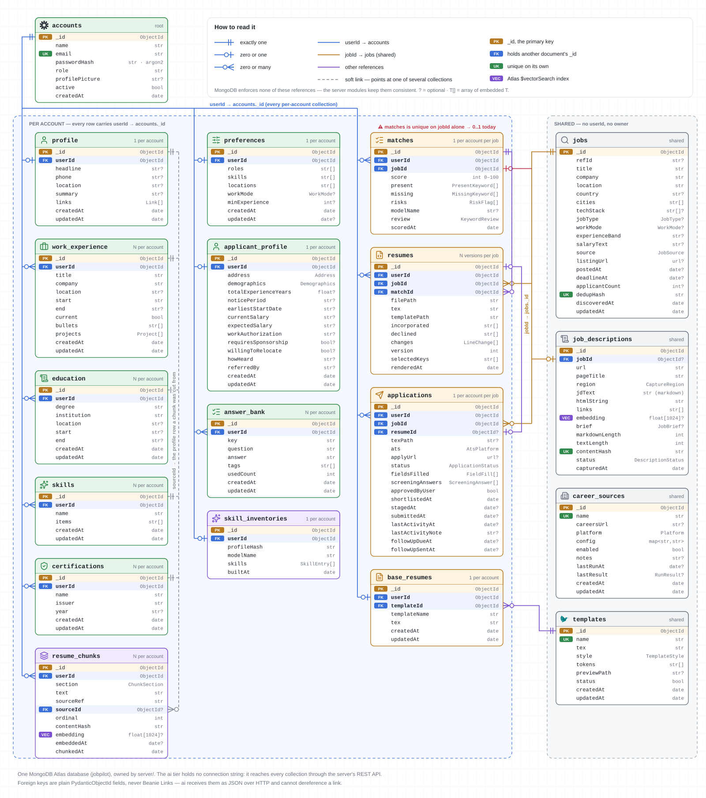

# 06 — Data Model / ER

The Beanie documents behind `server/modules/`: 19 collections in one MongoDB Atlas database,
`jobpilot`, owned by `server`. The `ai` tier holds no connection string; it reaches every
collection through the server's REST API with the user's JWT forwarded.

For an interactive version, see [10 — Data Model (ER)](10-Data-Model-ER.html). It lets you filter
collections, pick a view, and see what references what.

**Every document's primary key is MongoDB's own `_id` (`ObjectId`).** Beanie maps it to `id`;
no document declares a surrogate key. Foreign keys are plain `PydanticObjectId` fields, indexed, and
never Beanie `Link`s. `ai` receives these ids as JSON over HTTP and cannot dereference a link.

**Two join keys carry the whole model.**
- `userId` ties every per-account row to `accounts._id`.
- `jobId` ties your pipeline to the shared `jobs` catalogue.

A posting belongs to nobody. What you did about a posting is yours.

---

## Entity relationships

<picture>
  <source media="(prefers-color-scheme: dark)" srcset="er-diagram-dark.svg">
  
</picture>

The left area holds the 15 per-account collections: `accounts` and the 14 that point at it.
The right area holds the four shared ones.

| Line | Join |
|---|---|
| Blue | `userId` → `accounts._id`, drawn as one bus |
| Amber | `jobId` → `jobs._id` |
| Purple | `matchId`, `resumeId` and `templateId` |
| Dashed | `resume_chunks.sourceId`, a soft link to whichever profile row a chunk was cut from |
| Red | `matches.jobId`, whose index breaks with a second account (see [Known issues](#known-issues)) |

`answer_bank` has no line to `applications`. The extension matches an answer to a form field by
question key at fill time, so a foreign key would imply a link the schema does not have.
`career_sources` has no line to `jobs` either. A scraped job carries `source = career_page` and the
company name, not a source id.

Also available as [`er-diagram.png`](er-diagram.png) (2×) for slides and tickets. The SVGs use
presentation attributes only, with no stylesheet and no webfonts, so they render anywhere.

```mermaid
erDiagram
    ACCOUNTS ||--o| PROFILE           : "userId"
    ACCOUNTS ||--o{ WORK_EXPERIENCE   : "userId"
    ACCOUNTS ||--o{ EDUCATION         : "userId"
    ACCOUNTS ||--o{ SKILLS            : "userId"
    ACCOUNTS ||--o{ CERTIFICATIONS    : "userId"
    ACCOUNTS ||--o| PREFERENCES       : "userId"
    ACCOUNTS ||--o| APPLICANT_PROFILE : "userId"
    ACCOUNTS ||--o{ ANSWER_BANK       : "userId"
    ACCOUNTS ||--o{ RESUME_CHUNKS     : "userId"
    ACCOUNTS ||--o| SKILL_INVENTORIES : "userId"
    ACCOUNTS ||--o{ MATCHES           : "userId"
    ACCOUNTS ||--o{ RESUMES           : "userId"
    ACCOUNTS ||--o{ APPLICATIONS      : "userId"
    ACCOUNTS ||--o| BASE_RESUMES      : "userId"

    JOBS ||--o| JOB_DESCRIPTIONS : "jobId, unique where set"
    JOBS ||--o| MATCHES          : "jobId, unique alone today (should be per account)"
    JOBS ||--o{ RESUMES          : "jobId, versioned"
    JOBS ||--o{ APPLICATIONS     : "jobId, one per account"

    MATCHES   ||--o{ RESUMES      : "matchId, the gate that allowed it"
    RESUMES   |o--o| APPLICATIONS : "resumeId, the newest version"
    TEMPLATES ||--o{ BASE_RESUMES : "templateId"

    PROFILE         |o..o{ RESUME_CHUNKS : "sourceId"
    WORK_EXPERIENCE |o..o{ RESUME_CHUNKS : "sourceId"
    EDUCATION       |o..o{ RESUME_CHUNKS : "sourceId"
    SKILLS          |o..o{ RESUME_CHUNKS : "sourceId"
    CERTIFICATIONS  |o..o{ RESUME_CHUNKS : "sourceId"

    ACCOUNTS {
        ObjectId _id PK
        string   name
        string   email UK
        string   passwordHash "argon2"
        string   role
        string   profilePicture
        bool     active
        datetime createdAt
    }

    PROFILE {
        ObjectId _id PK
        ObjectId userId FK "unique"
        string   headline
        string   phone
        string   location
        string   summary
        array    links "embedded Link: label, value"
        datetime createdAt
        datetime updatedAt
    }

    WORK_EXPERIENCE {
        ObjectId _id PK
        ObjectId userId FK
        string   title
        string   company
        string   location
        string   start "free text, as written"
        string   end
        bool     current
        array    bullets
        array    projects "embedded Project: name, bullets"
        datetime createdAt
        datetime updatedAt
    }

    EDUCATION {
        ObjectId _id PK
        ObjectId userId FK
        string   degree
        string   institution
        string   location
        string   start
        string   end
        datetime createdAt
        datetime updatedAt
    }

    SKILLS {
        ObjectId _id PK
        ObjectId userId FK
        string   name "the group"
        array    items
        datetime createdAt
        datetime updatedAt
    }

    CERTIFICATIONS {
        ObjectId _id PK
        ObjectId userId FK
        string   name
        string   issuer
        string   year
        datetime createdAt
        datetime updatedAt
    }

    PREFERENCES {
        ObjectId _id PK
        ObjectId userId FK "unique"
        array    roles
        array    skills
        array    locations
        enum     workMode "on_site | hybrid | remote"
        int      minExperience
        datetime createdAt
        datetime updatedAt
    }

    APPLICANT_PROFILE {
        ObjectId _id PK
        ObjectId userId FK "unique"
        object   address "embedded: line1, line2, city, state, postalCode, country"
        object   demographics "embedded: gender, race, veteranStatus, disabilityStatus"
        float    totalExperienceYears
        string   noticePeriod
        string   earliestStartDate
        string   currentSalary
        string   expectedSalary
        string   workAuthorization
        bool     requiresSponsorship
        bool     willingToRelocate
        string   howHeard
        string   referredBy
        datetime createdAt
        datetime updatedAt
    }

    ANSWER_BANK {
        ObjectId _id PK
        ObjectId userId FK
        string   key "unique with userId"
        string   question
        string   answer
        array    tags
        int      usedCount
        datetime createdAt
        datetime updatedAt
    }

    RESUME_CHUNKS {
        ObjectId _id PK
        ObjectId userId FK
        enum     section "headline | summary | experience | project | skill | education | certification"
        string   text "copy of the profile text"
        string   sourceRef
        ObjectId sourceId FK "soft: any profile collection"
        int      ordinal
        string   contentHash "unique with userId"
        array    embedding "1024 floats; chunk_embedding_index"
        datetime embeddedAt
        datetime chunkedAt
    }

    SKILL_INVENTORIES {
        ObjectId _id PK
        ObjectId userId FK "unique"
        string   profileHash
        string   modelName
        array    skills "embedded SkillEntry: id, label, aliases, kind, source, evidence"
        datetime builtAt
    }

    MATCHES {
        ObjectId _id PK
        ObjectId userId FK
        ObjectId jobId FK "unique alone today"
        int      score "0-100"
        array    present "embedded PresentKeyword: label, chunkId"
        array    missing "embedded MissingKeyword: key, label, mentions, evidence, nearMiss"
        array    risks "embedded RiskFlag: key, title, detail; never selectable"
        string   modelName
        object   review "embedded KeywordReview: state, selectedKeys, reviewedAt"
        datetime scoredAt
    }

    RESUMES {
        ObjectId _id PK
        ObjectId userId FK
        ObjectId jobId FK
        ObjectId matchId FK
        string   filePath "ai/output/tailored/{job}-{ts}.tex"
        string   tex "the whole file"
        string   templatePath
        array    incorporated
        array    declined
        array    changes "embedded LineChange: lineNo, text, previous"
        int      version "unique with jobId"
        array    selectedKeys "snapshot of the gate decision"
        datetime renderedAt
    }

    APPLICATIONS {
        ObjectId _id PK
        ObjectId userId FK
        ObjectId jobId FK "unique with userId"
        ObjectId resumeId FK "null until a resume exists"
        string   texPath "copy of resumes.filePath"
        enum     ats "workday | greenhouse | lever | linkedin_easy_apply | other"
        url      applyUrl
        enum     status "shortlisted | staged | applied | viewed | interview | offer | rejected | withdrawn"
        array    fieldsFilled "embedded FieldFill: selector, label, value, source, highlighted"
        array    screeningAnswers "embedded ScreeningAnswer: question, answer, answeredByUser"
        bool     approvedByUser "set only with confirmedByUser"
        datetime shortlistedAt
        datetime stagedAt
        datetime submittedAt
        datetime lastActivityAt
        string   lastActivityNote
        datetime followUpDueAt "submittedAt + 5 days"
        datetime followUpSentAt
    }

    BASE_RESUMES {
        ObjectId _id PK
        ObjectId userId FK "unique"
        ObjectId templateId FK
        string   templateName "copy of templates.name"
        string   tex "stored verbatim"
        datetime createdAt
        datetime updatedAt
    }

    JOBS {
        ObjectId _id PK
        string   refId "the board's requisition id"
        string   title
        string   company
        string   location
        string   country
        array    cities
        array    techStack "only technologies the page names"
        enum     jobType "full_time | contract | part_time | internship"
        enum     workMode "on_site | hybrid | remote"
        string   experienceBand
        string   salaryText
        enum     source "linkedin | indeed | naukri | serpapi | career_page"
        url      listingUrl
        datetime postedAt
        datetime deadlineAt
        int      applicantCount
        string   dedupHash UK "FR-1.4 content hash"
        datetime discoveredAt
        datetime updatedAt
    }

    JOB_DESCRIPTIONS {
        ObjectId _id PK
        ObjectId jobId FK "unique where set"
        string   url
        string   pageTitle
        enum     region "main | article | heuristic | body | feed"
        string   jdText "markdown"
        string   htmlString
        array    links
        array    embedding "1024 floats; jd_embedding_index"
        object   brief "embedded JobBrief: requirements, seniority, minYears, locationRule, workMode, modelName, briefVersion, builtAt"
        int      markdownLength
        int      textLength
        string   contentHash UK
        enum     status "raw | parsed | discarded"
        datetime capturedAt
    }

    CAREER_SOURCES {
        ObjectId _id PK
        string   name UK
        string   careersUrl
        enum     platform "workday"
        object   config "tenant, wd, site"
        bool     enabled
        string   notes
        datetime lastRunAt
        object   lastResult "embedded RunResult: fetched, matched, new, duplicate, failed, blocked, error"
        datetime createdAt
        datetime updatedAt
    }

    TEMPLATES {
        ObjectId _id PK
        string   name UK
        string   tex "with {{TOKEN}} placeholders"
        object   style "embedded TemplateStyle: contact, skills, experience, location, columns"
        array    tokens
        string   previewPath
        bool     status "active"
        datetime createdAt
        datetime updatedAt
    }
```

Mermaid source, with every field

---

## Module ownership

| Collection | Owning module | Scope |
|---|---|---|
| `accounts` | `account` | one per person |
| `profile`, `work_experience`, `education`, `skills`, `certifications` | `profile` | per account |
| `preferences` | `preference` | per account |
| `applications`, `answer_bank`, `applicant_profile` | `application` | per account |
| `matches` | `match` | per account |
| `resumes`, `base_resumes` | `resume` | per account |
| `resume_chunks` | `resume_chunk` | per account |
| `skill_inventories` | `skill_inventory` | per account |
| `jobs` | `job` | shared |
| `job_descriptions` | `job_description` | shared |
| `career_sources` | `career_source` | shared |
| `templates` | `template` | shared |

`status` and `error_log` own no collection:
- `status` gathers its counts from other modules' public interfaces.
- `error_log` reads and writes the file `logs/errors.jsonl`.

A module queries only its own collections. Cross-module reads go through the other module's
`__init__.py`; for example, `match/service.py` calls `job.get_job()`.

**Exceptions: read-only `$lookup`s that join another module's collection in one round trip.**
- `job/service.py` joins `job_descriptions`, `matches` and `applications`, for Search and Job
  details.
- `application/service.py` joins `jobs` and `matches`, for the board, the tracker and the
  shortlist.
- `profile/service.py` assembles the profile with an aggregation that starts from `accounts`.

Every per-account join filters on the caller's `userId`. None of them writes outside its own module.

---

## Indexes

| Collection | Index | Why |
|---|---|---|
| `accounts` | `email` **unique** | sign-in name |
| `profile`, `preferences`, `applicant_profile`, `skill_inventories`, `base_resumes` | `userId` **unique** | one per account |
| `work_experience`, `education`, `skills`, `certifications` | `userId` | My details reads them all at once |
| `answer_bank` | `(userId, key)` **unique** | one answer per question key per account |
| `resume_chunks` | `(userId, contentHash)` **unique** | a concurrent re-index cannot double the set |
| `resume_chunks` | `(userId, ordinal)` · `(userId, embedding)` | profile order; the "not yet embedded" queue |
| `resume_chunks` | `chunk_embedding_index`: Atlas vector search, 1024-d, cosine, filter `userId` | nearest profile span per missing keyword |
| `matches` | `jobId` **unique** ⚠ | meant as one per account per job. See [Known issues](#known-issues) |
| `matches` | `(userId, review.state)` · `(userId, score desc)` | the "⚠ Pending your review" count; score order |
| `resumes` | `(jobId, version desc)` **unique** ⚠ | per-job `.tex` versioning. See [Known issues](#known-issues) |
| `applications` | `(userId, jobId)` **unique** | one row per account per job |
| `applications` | `(userId, status, stagedAt desc)` · `(userId, followUpDueAt)` | board columns and tracker; follow-up sweep |
| `jobs` | `dedupHash` **unique** | FR-1.4: the same posting from two boards collapses to one row |
| `jobs` | `discoveredAt desc` | every list is newest first |
| `job_descriptions` | `contentHash` **unique** | the same page captured twice is stored once |
| `job_descriptions` | `jobId` **unique**, partial (only where set) | one description per job; unparsed captures have none |
| `job_descriptions` | `(status, capturedAt desc)` · `url` | the parse queue; "stored already?" during discovery |
| `job_descriptions` | `jd_embedding_index`: Atlas vector search, 1024-d, cosine | created, but nothing queries it yet |
| `career_sources` | `name` **unique** · `(enabled, platform)` | the discovery run's company list |
| `templates` | `name` **unique** · `(status, name)` | the template picker |

Search filters with case-insensitive regex on `jobs` fields, so there is no text index.

The two vector indexes are created at startup by `server/config/database.py`, only when the URI is
`mongodb+srv://`. Beanie manages every other index.

---

## Where the guardrails live in the schema

| Invariant | How the model enforces it |
|---|---|
| **No fabrication** (FR-2.5, NFR-8) | `matches.review` starts `pending`, and a validator rejects a non-empty `selectedKeys` while pending. `POST /match/selection` accepts only keys from `matches.missing`. `store_resume()` refuses to store with 409 unless the state is `selected`, and refuses with 422 any `incorporated` label outside the selection. `resumes.selectedKeys` keeps the snapshot that justifies each line in `changes`. `risks` are never selectable. Each `skill_inventories` entry carries verbatim `evidence` from the profile. |
| **No auto-submit** (FR-5.3, NFR-7) | `applications.status` reaches `applied` only through a transition carrying `confirmedByUser`; without it the server returns 409. That transition sets `approvedByUser`, `submittedAt` and `followUpDueAt`. No other code path writes `applied`. |
| **One store** (supersedes the split store) | `server` opens the one connection, in `config/database.py`. `ai` holds no URI, which a guardrail test checks. Vectors sit next to their text on `resume_chunks` and `job_descriptions`; there is no second store to keep in step. |
| **`.tex` as the artifact** (FR-4.4) | `resumes.tex` and `resumes.filePath` are the only stored output. A PDF is compiled on demand by `pdflatex` (`resume/compile.py`) for the download button and never stored. This is a deliberate reversal, recorded in that file. |
| **Localhost only** (NFR-4) | `server` and `ai` default to `127.0.0.1`. CORS admits the Next dev origin and `chrome-extension://` only. |
| **Every step pauses** (FR-7.3) | `matches.review.state` is the keyword interrupt in persisted form. `applications.status = staged` is the submit interrupt. Each leaves its waiting state only on a user action. |
| **robots.txt** (FR-1.3) | No longer a schema field. `ai/sources/http.py` checks robots.txt on every request with no switch to turn it off. The docstring there still names `DiscoveryPreferences.respect_robots`, which no longer exists. |

---

## Screen → collection map

| Screen | Reads | Writes |
|---|---|---|
| Login / Signup | `accounts` | `accounts` |
| Pipeline board | New: `jobs` with no `applications` row of yours. Other columns: your `applications` by `status`, joined with `jobs` and `matches` | — |
| Search | `jobs`, joined with your `matches` and `applications` | `applications` (shortlist toggle) |
| Shortlist | your `shortlisted` `applications` → `jobs` + `matches` counts | `applications` |
| Applications | your `applications` (shortlisted, staged, submitted) + `jobs` | — |
| Job details | `jobs` + `job_descriptions` + your `matches` + `applications` | `jobs` (through analysis) |
| Keyword Selection ⚠ | `matches.present` / `.missing` / `.risks` | `matches.review` |
| Tailoring preview | your latest `resumes` version; the PDF is compiled from `resumes.tex` | `resumes`, `applications` (staged), via the ai tier |
| My details | `accounts`, `profile`, `work_experience`, `education`, `skills`, `certifications`; `resume_chunks` stats; `base_resumes` | the same, then `resume_chunks` on every edit |
| Resume | `templates`, `base_resumes` | `base_resumes` |
| Settings | `preferences`, `career_sources` | `preferences`, `career_sources.enabled` |
| Header and sidebar badges | `GET /status`: `applications`, `jobs`, `matches`, `career_sources`, `resume_chunks`, `base_resumes` | — |
| Extension: fill | `profile` (aggregate), `applicant_profile`, `answer_bank`, staged `applications`, `jobs`, `base_resumes` (PDF) | `applications.fieldsFilled` / `.screeningAnswers`; `status = applied` on your confirmation |
| Extension: capture | — | `job_descriptions`, then `jobs` through the ai tier |

The ai tier writes `jobs`, `job_descriptions`, `matches`, `skill_inventories`,
`resume_chunks.embedding`, `resumes` and `career_sources.lastResult`, all through the server's REST
API.

---

## Known issues

| Collection | Problem | Fix |
|---|---|---|
| `matches` | `jobId` is unique on its own, but jobs are shared. A second account scoring the same job gets a duplicate-key error (500). | make the index `(userId, jobId)` unique |
| `resumes` | `(jobId, version)` is unique without `userId`, so two accounts tailoring one job collide on version 1 | make it `(userId, jobId, version)` unique |
| `job_descriptions` | every JD is embedded through Voyage and indexed, but nothing queries `jd_embedding_index` | query it, or stop embedding JDs |
| `applications` | `followUpSentAt` is never written; the tracking agent is not built | lands with the tracking agent |

---

## Deliberate absences

- **No `events` collection.** The timeline lives on `applications` as `shortlistedAt`, `stagedAt`,
  `submittedAt`, `lastActivityAt` and `lastActivityNote`. A separate audit trail waits for the
  tracking agent.
- **No sessions or refresh-token collection.** Access and refresh tokens are stateless HS256 JWTs.
- **No `settings` collection.** Each account's discovery targets are in `preferences`. Model names
  and scrape limits come from the ai tier's environment, through `GET /api/settings`.
- **No separate vector store.** Embeddings sit on `resume_chunks` and `job_descriptions`, so a
  vector hit returns its text with no second lookup.
- **No stored PDFs.** They are compiled from `.tex` on request.
- **No error-log collection.** Errors from server, ai and web go to the JSON Lines file
  `logs/errors.jsonl`.
- **No `cover_letters`.** Out of v1 scope (PRD §5).
